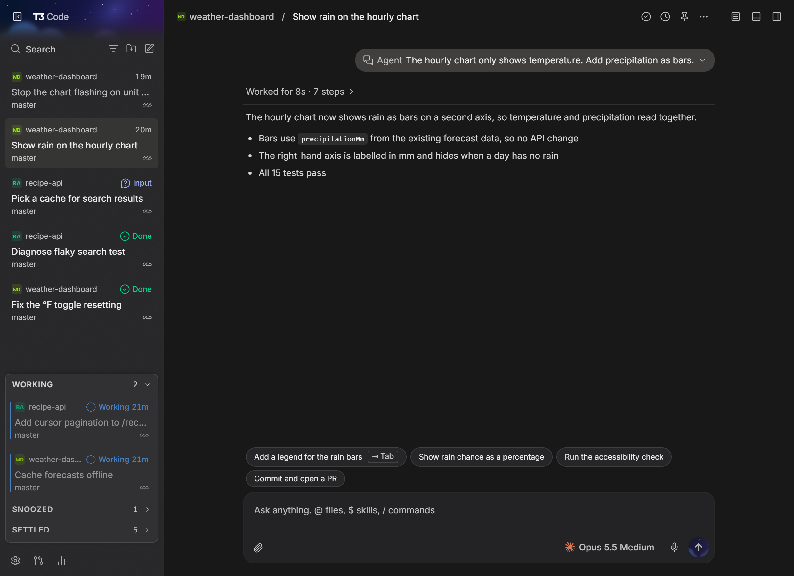
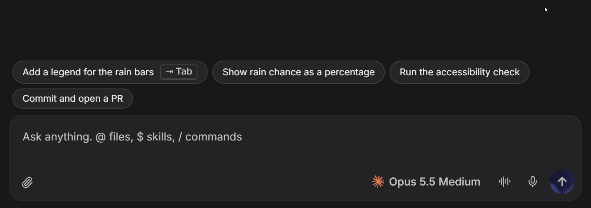
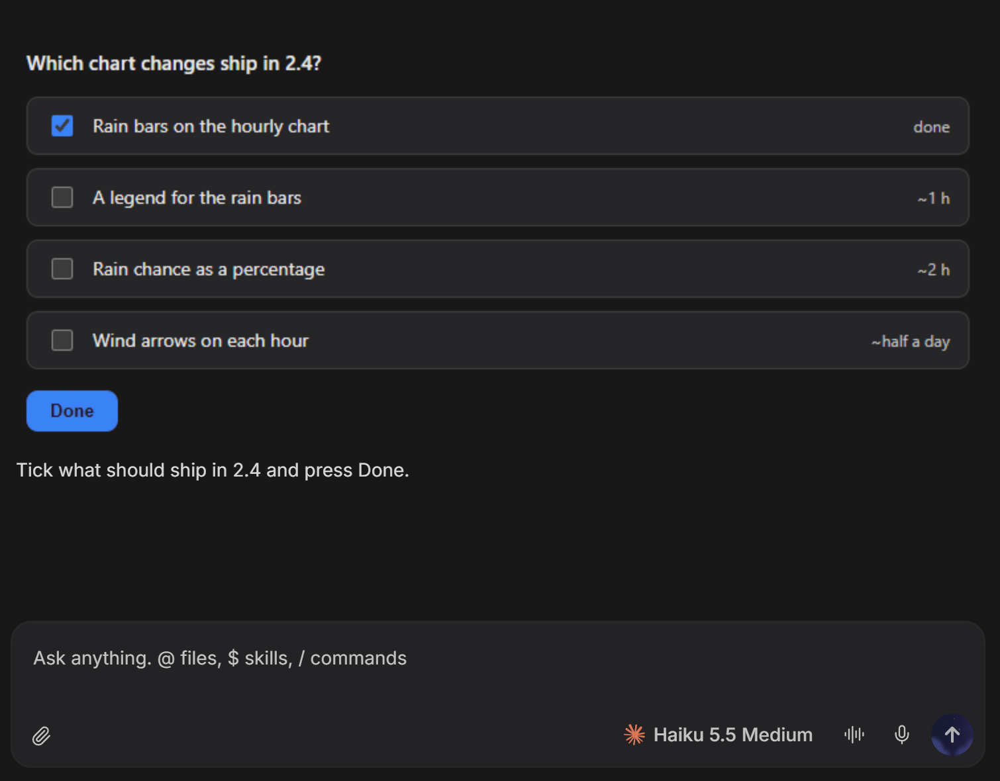
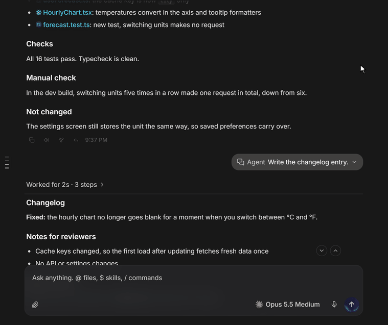
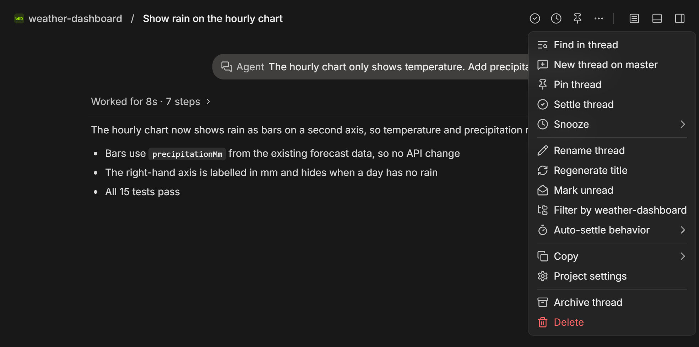
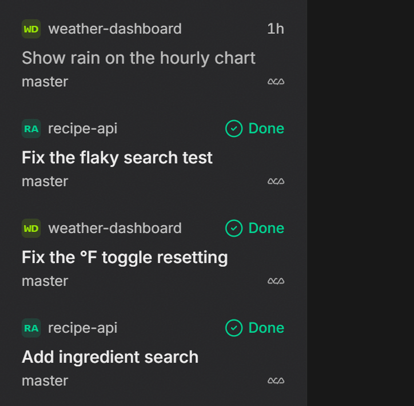
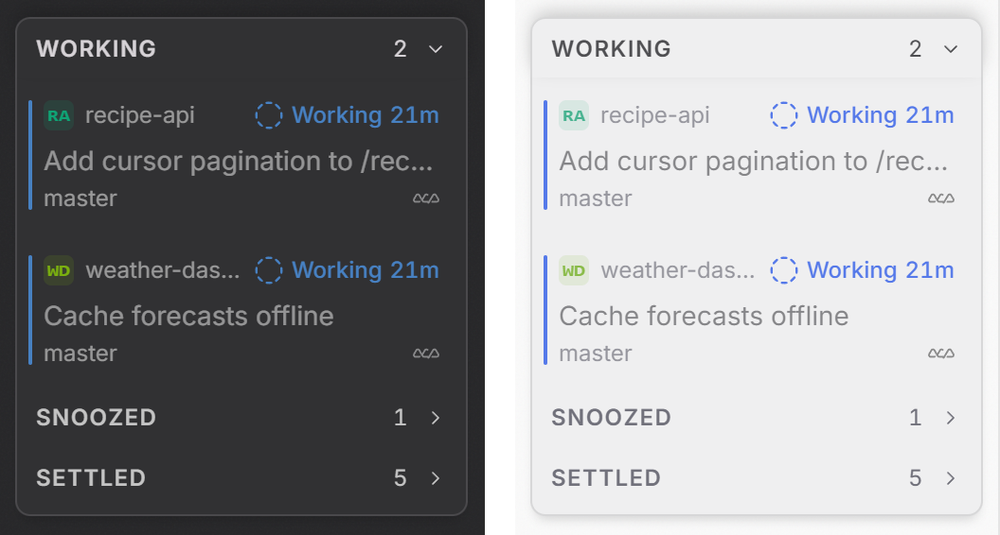
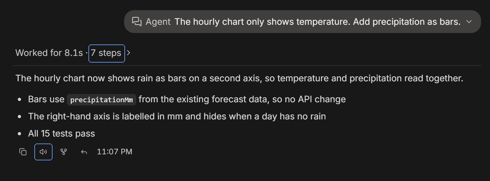
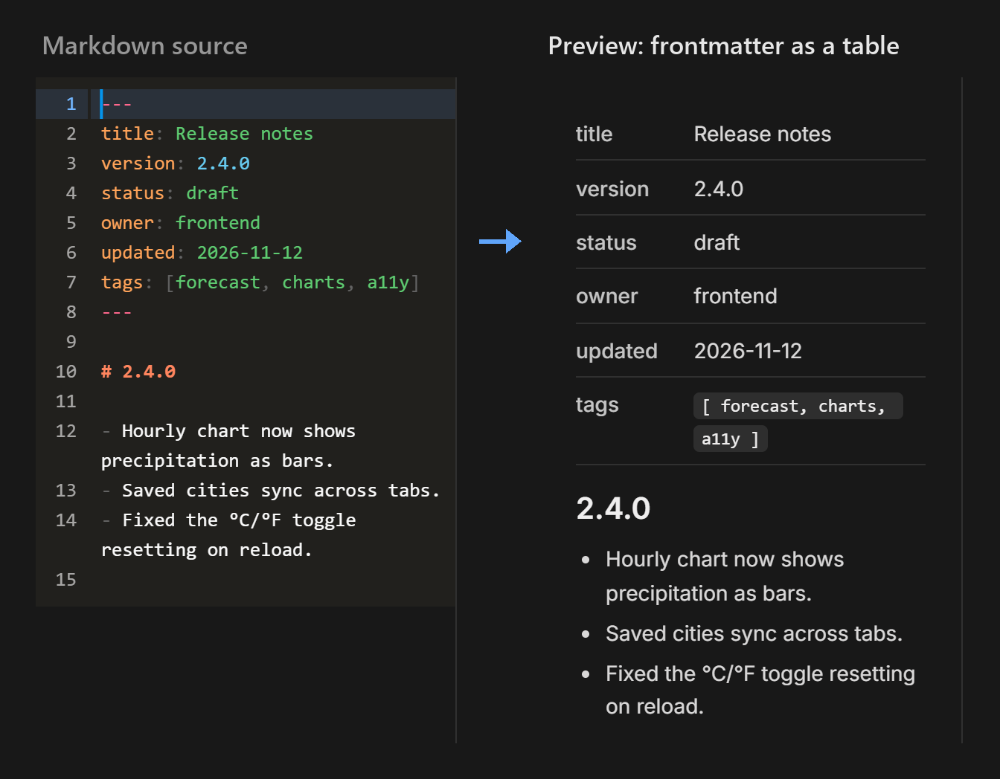

<h1 align="center">T3 Code (ryankhart's fork)</h1>

  A desktop app for Claude Code, Codex and other coding agents. This fork adds next-prompt buttons, ballots, prompt-to-prompt jumps, read-aloud replies and a tidier sidebar on top of T3 Code and MT Code.

  
  

  <a href="https://github.com/ryankhart/t3code/releases/latest"><b>Download for Windows / Android</b></a>
&ensp;•&ensp;
  <a href="#whats-new-in-this-fork">What's new</a>
&ensp;•&ensp;
  <a href="./FORK.md">How this fork works</a>
&ensp;•&ensp;
  <a href="https://github.com/munimtechnologies/mtcode#readme">MT Code</a>
&ensp;•&ensp;
  <a href="https://github.com/pingdotgg/t3code#readme">T3 Code</a>

  <picture>
    <source media="(prefers-color-scheme: dark)" srcset="./.github/readme/fork/hero-dark.png">
    <source media="(prefers-color-scheme: light)" srcset="./.github/readme/fork/hero-light.png">
    
  </picture>

## What this is

It's built in three layers:

1. **[T3 Code](https://github.com/pingdotgg/t3code)**, the original app by Theo and the T3 team.
2. **[MT Code](https://github.com/munimtechnologies/mtcode)**, Munim Technologies' fork of T3 Code. It adds a lot on top (Computer Use, realtime voice, a plugin marketplace and more) and merges T3 Code regularly. See [everything MT Code adds](https://github.com/munimtechnologies/mtcode#mt-code-vs-t3-code).
3. **This fork**: the features below, kept as a short stack of commits on top of each MT Code release and rebuilt automatically.

You get everything T3 Code and MT Code do, plus the extras here. The app shows the name "T3 Code", but underneath it's MT Code's build, so it shares MT Code's settings folder (`~/.mt`) and an existing MT Code install upgrades in place.

## What's new in this fork

### Next-prompt buttons

After a run, up to four buttons float above the message box with likely next messages. Click one to add it to your message, click another to add that too, and click again to take one back out. Nothing is sent until you press Send.

  

- An agent can end its reply with a fenced `options` block, one next message per line. The app hides the block and shows the lines as buttons, instead of a multiple-choice pop-up that covers half the window.
- With the Labs **Suggest next prompt** switch on, the provider's own guess and a small model's picks show up too, including skills and slash commands (a slash command goes first, where it runs).
- **Tab** takes the first suggestion you haven't picked yet, **Escape** hides them.

### Ballots: pick from a page, straight into your message

When an agent shows you choices as an inline page, its **Done** button drops your picks into that thread's message box. It never sends anything: you review the text and press Send yourself.

  

For agent authors: an `html_render` page calls `t3Compose(text)`, which only adds text, only after a real click, and only to the thread the page is in.

### Jump between your prompts

Two round arrow buttons sit at the right edge of a chat, level with **Scroll to end**. **↑ Previous prompt** first goes back to the message that started the reply you're reading, then one message earlier per click. **↓ Next prompt** goes one message later. Long replies no longer mean scrolling to find where you were.

  

Above the first loaded prompt, ↑ goes to the very top, where **Load earlier turns** appears when there's more history. ↑ hides at the top of the chat and ↓ at the last prompt; each keeps its place when the other hides.

### Every thread action in the thread header

Settle, Snooze and Pin buttons sit at the top of the open thread and show when they're on. **⋯** holds every action from the thread's sidebar menu (rename, regenerate title, new thread on this branch, filter the sidebar by this project, archive, copy and the rest) plus **Find in thread**, so closing the sidebar loses nothing. An unsent draft's ⋯ matches its sidebar row too. If Snooze is greyed out, hover it to see why.

  <picture>
    <source media="(prefers-color-scheme: dark)" srcset="./.github/readme/fork/header-dark.png">
    <source media="(prefers-color-scheme: light)" srcset="./.github/readme/fork/header-light.png">
    
  </picture>

### Titles shimmer while they regenerate

Ask for a new title and the old one shimmers until the new one lands, so you can tell it's about to change.

  

### Working, Snoozed and Settled docked in one tray

Working, Snoozed and Settled threads sit together in one raised card at the bottom of the sidebar, with small uppercase headers, so a long thread list no longer runs straight into them. Each running thread gets a thin blue bar on its left edge.

  

### Read replies aloud, and see how much work a run took

A speaker button beside Copy reads the final reply with Microsoft Edge's natural voices. Code blocks are read as "Code block" and file paths as file names. A collapsed run shows how many steps it took.

  

Pick the voice in **Settings → General → Read aloud**. It needs the [`edge-tts`](https://github.com/rany2/edge-tts) command (`uv tool install edge-tts`); without it, the basic Windows voice is used.

### Markdown frontmatter as a table

The `---` properties block at the top of a Markdown file shows as a neat table in the file preview instead of raw text.

  

### And more

| Feature                                       | What it does                                                                                                                                                                                                                      |
| --------------------------------------------- | --------------------------------------------------------------------------------------------------------------------------------------------------------------------------------------------------------------------------------- |
| **Chrome extensions in the built-in browser** | Add extensions from the Chrome Web Store with the toolbar's Extensions button. Toolbar ones such as Bitwarden get their own button with their popup. Each browser profile has its own, and they update themselves.                |
| **Settle a thread that's asking a question**  | Settling used to fail while the agent waited on a multiple-choice question. Now Settle dismisses the question, stops that run and settles, from any entry point (sidebar, header, shortcut, phone). Approvals still block Settle. |
| **Move a No project thread into a project**   | A thread started without a project can move into an existing project from its menu, also after **Turn into project**. It then works in the project's folder, and its conversation resumes there.                                  |
| **New thread button setting**                 | **Settings → General → Sidebar → New thread button**: "No project" makes New thread start a scratch thread straight away instead of opening the project picker. Shift+click still starts in the current project.                  |
| **Search Google for selected text**           | Right-click selected text and choose **Search Google for "…"** to look it up in your default browser.                                                                                                                             |

### On your phone (Android)

The same features come to the Android app: next-prompt buttons (tap to add, tap again to remove), `options` blocks as buttons, ballots filling the message box, Previous / Next prompt buttons, moving a No project thread into a project, the New thread button setting, step counts, shimmering titles, frontmatter tables, and read aloud. Plus these phone-only additions:

| Feature                         | What it does                                                                                                                                                                                                                                                                                                                                                                                                                                                                                                                                                                                                                                                         |
| ------------------------------- | -------------------------------------------------------------------------------------------------------------------------------------------------------------------------------------------------------------------------------------------------------------------------------------------------------------------------------------------------------------------------------------------------------------------------------------------------------------------------------------------------------------------------------------------------------------------------------------------------------------------------------------------------------------------- |
| **Settle from the thread**      | A checkmark in the open thread's header settles it and goes back to the list, with Undo for 10 seconds. On a settled thread the checkmark un-settles it. The header's ⋮ menu holds Files, Git and Terminal plus every action the thread's list row offers, in the same order.                                                                                                                                                                                                                                                                                                                                                                                        |
| **Pinned threads sidebar**      | Pinned threads leave the top of the thread list for their own sidebar. Swipe right on the list, or tap the pin button left of the logo, to slide it in from the left; tap the strip beside it, swipe it back left, or press Back to return to the list. Pinned threads still show up in search results.                                                                                                                                                                                                                                                                                                                                                              |
| **Back to where you were**      | Going back from a thread scrolls the list to that thread and highlights it once.                                                                                                                                                                                                                                                                                                                                                                                                                                                                                                                                                                                     |
| **Bottom pill**                 | The scroll-to-end arrow is a pill labelled **Bottom**, so it can't be mixed up with the ↓ Next prompt button beside it.                                                                                                                                                                                                                                                                                                                                                                                                                                                                                                                                              |
| **Start without a project**     | A new thread's heading has an "or start without a project" link under it, as on desktop: one tap instead of two.                                                                                                                                                                                                                                                                                                                                                                                                                                                                                                                                                     |
| **Android's digital assistant** | Pick T3 Code Fork under Android's **Default apps → Digital assistant app**. Then the assistant gesture (such as holding the side button) opens a new No project thread in talk mode (below). If no connected PC offers No project threads, it opens the new-thread screen instead.                                                                                                                                                                                                                                                                                                                                                                                   |
| **Talk mode**                   | A spoken conversation: it listens, sends what you said after a short pause, reads the reply aloud (starting at its first finished sentence, while the agent is still writing) and listens again. The agent is asked for short spoken answers, and that request stays out of sight. A bar above the message box shows the step and stops it; it also stops when you stay quiet, leave the thread, or the agent needs a tap from you.                                                                                                                                                                                                                                  |
| **Dictation style**             | Dictation no longer breaks sentences or adds question marks where you pause to think. **Settings → Voice** has the options: show the words as you speak or only when you finish; quick fixes on the phone (join sentences split by pauses, question marks only for questions, remove "um" and "uh"); and an AI cleanup on your PC when you finish that re-punctuates with the whole recording as context, with switches for grammar, stutters, changes of mind (kept by default, so your thinking shows), lists, paragraphs, spoken commands, code words, tighter wording and your own instructions. The checkmark skips the cleanup; talk mode skips it on its own. |
| **Updates itself**              | On Wi-Fi (any connection Android doesn't call metered) the app downloads the newest release, checks it, and installs it when you leave the app. If Android needs a tap, it asks when you come back. Allow "Install unknown apps" for it once, when it asks. To update now, tap **Settings → Check for updates**, then **Update to …**: it downloads (on any connection) and installs, then reopens, or shows an "Updated" notification to tap when Android doesn't allow that.                                                                                                                                                                                       |

Read aloud on the phone uses a small speech service on the paired PC (port 3776 over Tailscale), because the phone's own voices are poor. It works over a direct Tailscale connection, not a relay. Details in [FORK.md](./FORK.md#phone-app).

### Fixes

- **Phone app no longer crashes after pairing.** MT Code's computer-task code needs `crypto.getRandomValues`, which the phone's JavaScript engine lacks; this build supplies it.
- **Settling a waiting question can't send the agent a blank answer.** Stop withdraws the question properly instead of answering it empty.
- **Copy buttons work in inline pages on the phone.**

## Download

Get the newest release from **[GitHub Releases](https://github.com/ryankhart/t3code/releases/latest)**:

- **Windows** (x64): `T3-Code-Fork-<version>-x64.exe`
- **Android**: `T3-Code-Fork-<version>.apk`, sideloaded. It installs as a separate app named "T3 Code Fork", next to the official T3 Code app, and pairs with the desktop app like the official one does.

There are no macOS or Linux builds. The Windows installer is unsigned: if SmartScreen warns, choose **More info → Run anyway**.

The desktop app updates itself from this repository's releases. It checks 15 seconds after it starts and then every 4 hours. Heads-up: when it finds a new release, it downloads it, then installs it and restarts by itself, which stops any agent runs in progress.

Because it uses MT Code's app identity and data folder, it replaces MT Code rather than installing beside it. Your MT Code threads, settings and projects carry over. It does install beside official T3 Code, which uses `~/.t3`.

## Before you start

The app drives agents you already have. Install and sign in to at least one provider CLI:

- Claude: install [Claude Code](https://claude.com/product/claude-code) and run `claude`
- Codex: install [Codex CLI](https://developers.openai.com/codex/cli) and run `codex login`
- Cursor: install [Cursor CLI](https://cursor.com/cli) and run `agent login`
- Grok Build: install [Grok Build CLI](https://x.ai/cli) and run `grok login`
- OpenCode: install [OpenCode](https://opencode.ai) and run `opencode auth login`
- Kiro, Pi, Muse Code, fx and Antigravity work too; see [MT Code's setup list](https://github.com/munimtechnologies/mtcode#before-you-start).

Your existing subscriptions are used directly. Nothing here sells anything, adds accounts, or sends your work anywhere except to the providers you use.

## How it stays up to date

Every four hours a GitHub Actions pipeline checks for a new MT Code release. When there is one, it re-applies this fork's commits on top, runs the tests for the files those commits touch, builds the Windows installer and the Android APK, checks each fork feature is inside the installer, and only then publishes a release. If anything fails, nothing is published and installed copies stay as they are. When MT Code or T3 Code ships its own version of a fork feature, the fork's copy is dropped.

The full explanation, including branches and version numbers, is in [FORK.md](./FORK.md).

## Documentation

- What MT Code adds over T3 Code, and its docs list: [MT Code's README](https://github.com/munimtechnologies/mtcode#readme)
- T3 Code itself: [T3 Code's README](https://github.com/pingdotgg/t3code#readme) and [docs](https://github.com/pingdotgg/t3code/tree/main/docs)
- User guides shipped with this build: [docs/user](./docs/user) (remote access, keyboard shortcuts, permission modes, and more)
- How this fork is built and released: [FORK.md](./FORK.md)
- Building from source: start at [docs/internals/overview.md](./docs/internals/overview.md)

## Reporting problems

This is a one-person fork, public in case the features help someone else; there's no support promise. Problems with a feature listed above belong in [this repository's issues](https://github.com/ryankhart/t3code/issues). Please don't report this fork's problems to [MT Code](https://github.com/munimtechnologies/mtcode/issues) or [T3 Code](https://github.com/pingdotgg/t3code/issues); check first that the problem also happens in their own builds.

## Credits

All the hard work is [T3 Code](https://github.com/pingdotgg/t3code)'s and [MT Code](https://github.com/munimtechnologies/mtcode)'s. This fork exists because both are truly open. Licensed like MT Code: [Apache 2.0](./LICENSE), with T3 Code's parts under [MIT](./LICENSE-MIT); see [NOTICE](./NOTICE).
